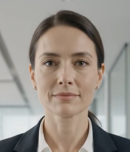
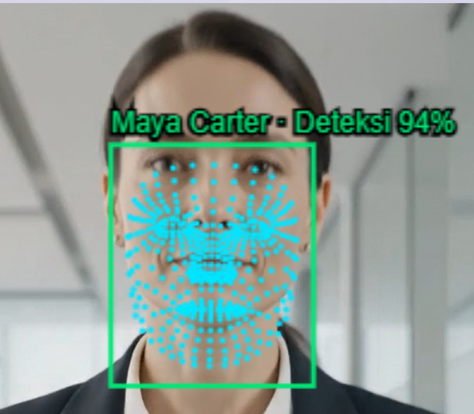
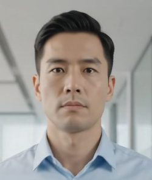
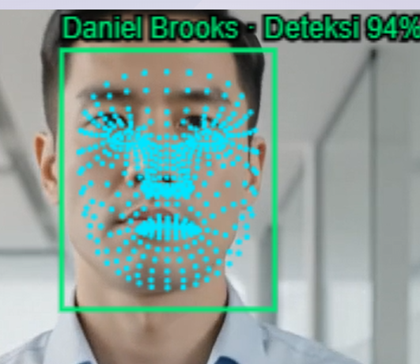
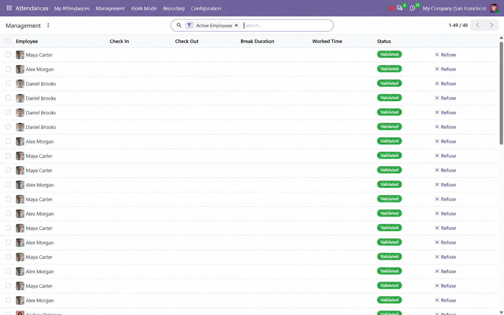
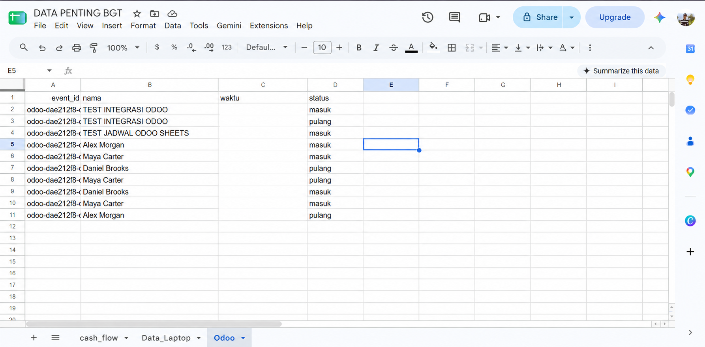

# Attendance Face Scan

An Odoo 20 module that recognizes employees in video, records attendance, and syncs events to Google Sheets.

## How it works

1. Select a video in the Odoo attendance kiosk.
2. YuNet detects faces; SFace generates a 128-dimensional embedding for each face.
3. pgvector compares embeddings with employee photos using cosine similarity. MediaPipe displays facial landmarks in the browser.
4. A recognized employee is checked in or out. An Odoo job sends attendance events to Google Sheets through Apps Script.

The percentage displayed on a face is the **face detection score**, not the probability of a correct identity match.

## Face detection

| Employee | Without detection | With detection |
| --- | --- | --- |
| Maya Carter |  |  |
| Daniel Brooks |  |  |

## Attendance and Google Sheets

## Requirements

Odoo 20 with `hr_attendance`, PostgreSQL with pgvector, the dependencies in `requirements-face.txt`, and YuNet/SFace model files. Set `FACE_SHEETS_URL` and `FACE_SHEETS_TOKEN` in the environment to enable Sheets sync. Keep secrets outside the repository.

## Performance and costs

On an Intel Core Gen 13 with 15.7 GiB RAM, a local test of one 250 × 295 image measured **11.4 ms median** for detection and embedding across 11 warm runs; model loading took 196.6 ms. This excludes browser rendering, database matching, attendance and Sheets sync. FPS, CPU usage during scanning, end-to-end latency and concurrent capacity have not been measured.

Detection runs locally without a paid AI API per scan. Hardware, electricity, maintenance, hosting and any applicable [Odoo license](https://www.odoo.com/pricing) remain potential costs. Google services have [usage quotas](https://developers.google.com/apps-script/guides/services/quotas); monthly costs depend on the deployment and usage.

## Risks and limitations

- **No liveness detection:** replayed video can trigger attendance again. Use in a trusted demo environment; add appropriate verification before production.
- **Recognition errors:** thresholds are configurable but have not been validated on the intended employee population. Test accuracy in real conditions and provide an alternative attendance method.
- **Repeated scans:** each employee is processed once per video session, with a 60-second cooldown. Check-in or check-out follows the current attendance state.
- **Sync delays:** unsent events remain queued for retry; stable event IDs help prevent duplicates. The job runs every minute and processes up to 50 events per run.
- **Privacy and security:** protect employee photos, embeddings, kiosk links and secrets. Restrict access, define retention and secure backups. Rotate any token previously shared. Video frames are not stored as evidence by this video scan flow.
- **Capacity:** multi-user load and accuracy across varied lighting, faces and video quality have not been validated.
